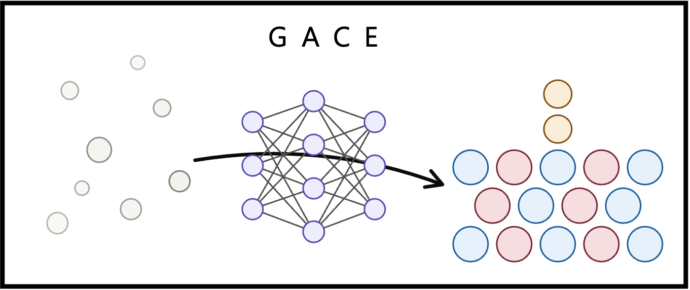

# GACE

**Generative Adsorbate–Catalyst Engineer.** A flow-matching model that generates catalyst + adsorbate structures de novo.



## Overview

Given an adsorbate and a target binding energy, GACE generates a catalyst bulk cell, its supercell matrix, and the adsorbate placement in a single flow. It is adapted from ZATOM-1, a 170M-parameter non-equivariant transformer, and fine-tuned on ~460k OC20 IS2RE configurations. Continuous quantities (positions, lattice, adsorbate geometry) follow a flow-matching path; atom types follow a masked discrete flow. Generated structures can be filtered for validity and relaxed with an OC20 MLFF.

## Installation

Clone the repo first; the configs and training script come from it.

```bash
git clone https://github.com/DeanMSweeney/gace.git
cd gace
```

**Docker (recommended).** The Dockerfiles expect `requirements.txt` at the repo root:

```bash
cp docker_pkg_info/requirements.txt .
docker build -f docker_pkg_info/Dockerfile.amd64 -t gace .   # x86_64 + CUDA 12.4
# docker build -f docker_pkg_info/Dockerfile.arm64 -t gace . # arm64 (e.g. GH200)
docker run --gpus all -it -v $(pwd):/workspace gace
```

**pip.** Python 3.10 with CUDA 12.4:

```bash
pip install torch==2.4.1 --index-url https://download.pytorch.org/whl/cu124
pip install torch_geometric pyg_lib torch-scatter torch-sparse torch-cluster torch-spline-conv \
  -f https://data.pyg.org/whl/torch-2.4.0+cu124.html
pip install --no-deps fairchem-core==1.10.0 torch-linear-assignment
pip install -r docker_pkg_info/requirements.txt
pip install -e .
```

## Usage

Everything runs through one Hydra entry point, `sandbox/train.py`. The config chooses what it does: `train.yaml`, `test.yaml` or `generate.yaml` in `configs/` (`train` and `test` load the architecture from `configs/model_cfg/tft-large.yaml`; `generate` uses the same values built into the code, so it needs only `generate.yaml`). Pick one with `--config-name` and override any field on the command line.

**Generate** structures for an adsorbate (POSCAR) at a target binding energy:

```bash
python sandbox/train.py --config-path ../configs --config-name generate \
  sampler_cfg.inputted_adsorbate=ads.vasp \
  sampler_cfg.target_binding_energy=-1.0 \
  sampler_cfg.num_generated_samples=10
```

If `ckpt_path` is not set, the checkpoint is downloaded from the Hugging Face repo `DeanMSweeney/gace`. Structures are written to `generated_strucs/`. Useful options: `sampler_cfg.target_element` (pin an element, e.g. `29` for Cu), `sampler_cfg.num_prim_atoms` (default 4), and `sampler_cfg.relax_otf=true` (MLFF relaxation).

**Evaluate** on a held-out split:

```bash
python sandbox/train.py --config-path ../configs --config-name test \
  oc20_test=/path/to/val_ood/dataset_processed.lmdb
```

**Train** (warm-started from the ZATOM-1 checkpoint via `ckpt_path`):

```bash
python sandbox/train.py --config-path ../configs --config-name train \
  oc20_train=/path/to/train/dataset_processed.lmdb \
  oc20_val=/path/to/val_id/dataset_processed.lmdb \
  ckpt_path=/path/to/zatom_1_xl_joint_pretraining_paper_weights.ckpt \
  resume_training=false
```

**Analyze** generated structures (validity, uniqueness, novelty, MLFF relaxation):

```bash
python scripts/process_strucs.py --traj_dirs generated_strucs/ --sanitize --eval_uniqueness --relax
```

All options and defaults are documented in `src/gace/helm/config.py`.
